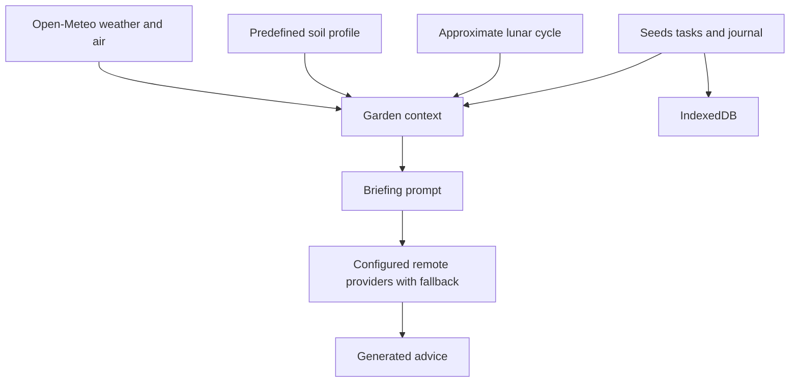

# Le Jardin de Niko — Terroir Synthétique

**Retained garden-management variant · Multi-provider fallback · Local records**

[Source](index.html) · [MIT](LICENSE) · [English overview](#english-overview)

## Architecture constatée



La source contient des adaptateurs Groq, Cerebras et Mistral, avec repli vers les fournisseurs configurés lorsque le précédent échoue. Ce mécanisme ne constitue pas une validation croisée des réponses. Le profil du sol est prédéfini, non mesuré ; les types de jours biodynamiques sont une convention calculée à partir du cycle lunaire moyen, sans efficacité agronomique établie.

> **Statut portfolio (octobre 2026) — variante conservée, non sélectionnée dans la vitrine.** Cette variante Terroir Synthétique est conservée pour ses modules de jardin, météo et semences. Le projet oracle-du-jardinier est retenu dans la vitrine principale ; il ne s'agit pas d'une fusion de code. Voir [la politique de sélection](https://github.com/Nikoju1977/Nikoju1977/blob/main/CURATION.md) et [le projet de référence](https://github.com/Nikoju1977/oracle-du-jardinier).


> **Terroir Synthétique** — Assistant agronomique IA pour jardin permacole, Loire-Atlantique (44)

Single-file HTML · zero build · progressive enhancement · PWA-ready

**🔗 Démo live** : [dépôt du projet (déploiement à confirmer)](https://github.com/Nikoju1977/le-jardin-de-niko)

---

## ✦ Fonctionnalités

L'Oracle du Jardinier fusionne **météo temps réel**, **phase lunaire biodynamique**, **qualité d'air** et **profil pédologique** pour générer un briefing agronomique quotidien adapté au terroir breton de La Meilleraye-de-Bretagne.

### Agents & données
- **MeteoAgent** — Open-Meteo API (sans clé) · température, humidité, vent, précipitations, UV
- **LunarAgent** — calcul biodynamique local (Feuille / Fruit / Racine / Fleur)
- **AirQualityAgent** — PM2.5 / PM10 / IQA européen via Open-Meteo
- **SoilAgent** — profil pédologique limono-argileux 44, pH 6.5

### Providers IA
- 🟢 **Groq** (quotas à vérifier · Llama 3.3 70B)
- 🔵 **Cerebras** (quotas à vérifier · Llama 3.3 70B)
- 🟣 **Mistral** (accès et modèles à vérifier)
- ↪ **Fallback automatique** en cas d'échec d'un fournisseur configuré

### Modules
- **Oracle** — briefing complet : À FAIRE · À ÉVITER · À ANTICIPER · synthèse
- **Météo** — courante + 7 jours + soleil/UV
- **Semences** — CRUD IndexedDB, cycle de statut (semé → germé → pousse → récolté)
- **Tâches** — échéances, toggle done, tri auto par urgence
- **Journal** — entrées horodatées du terrain
- **Config** — providers IA, export/import JSON

---

## 🎨 Design System — Terroir Synthétique

| Rôle | Fonte |
|------|-------|
| Display · Oracle · titres | **Fraunces** variable (opsz / SOFT / WONK) |
| Mesures · métadonnées | **JetBrains Mono** |
| Corps | **DM Sans** |

| Token | Couleur |
|-------|---------|
| `--soil-deep` | `#07100c` (forêt profonde) |
| `--chloro-500` | `#10b981` (chlorophylle) |
| `--ochre` | `#d4a574` (ochre breton) |
| `--terracotta` | `#c65d3a` (terre cuite) |

- SVG botaniques décoratifs en coins
- Grain SVG en overlay (blend mode)
- Animations fadeUp staggered (delays .05 → .30s)
- Safe-area-inset iOS + 100dvh

---

## 🚀 Déploiement

### GitHub Pages (si activé)
Configurer la publication depuis les réglages du dépôt ; un simple push sur `main` ne garantit pas qu'un site soit publié.

### Local
```bash
git clone https://github.com/Nikoju1977/le-jardin-de-niko.git
cd le-jardin-de-niko
python3 -m http.server 8000
# → http://localhost:8000
```

Aucun build, aucune dépendance npm. Tout est dans `index.html`.

---

## 🔑 Configuration des clés API

À la première utilisation, onglet **Config** :

1. **Groq** (recommandé en primaire) → [console.groq.com](https://console.groq.com) · conditions à vérifier
2. **Cerebras** (fallback rapide) → [cloud.cerebras.ai](https://cloud.cerebras.ai) · conditions à vérifier
3. **Mistral** (vision photo future) → [console.mistral.ai](https://console.mistral.ai) · conditions à vérifier

Les clés sont conservées via safeStorage (localStorage ou mémoire), sans chiffrement applicatif établi, et utilisées pour les requêtes aux fournisseurs.

---

## 📱 Compatibilité visée — non vérifiée

- Android Chrome / WebView (XMLHttpRequest → null-origin compat)
- iOS Safari (safe-area-inset + 100dvh + `-webkit-text-security`)
- Desktop Chrome / Firefox / Safari
- ⚠️ Internet Explorer non supporté

---

## 🛠 Stack

- **HTML / CSS / Vanilla JS** (ES5-compatible pour anciens WebViews)
- **IndexedDB** pour persistance (`OracleV24`, 4 stores)
- **Open-Meteo** pour météo + air (pas de clé requise)
- **XMLHttpRequest** over fetch (compat Android)

---

## 📊 Stats

- 🗂 **1 fichier** · `index.html`
- 📦 taille variable selon la révision
- ⚡ temps de rendu non mesuré
- 🔋 **Zero build** · zero dépendances npm

---

## 📝 Licence

MIT © 2026 Nicolas Julienne · [Studio Niko Design](https://github.com/Nikoju1977)

---

## 🌱 Credits

Construit à [La Meilleraye-de-Bretagne](https://fr.wikipedia.org/wiki/La_Meilleraye-de-Bretagne), Loire-Atlantique, avec passion pour la permaculture et le code.

**Niko Julienne Labs** · v24 · 2026


## Positionnement du projet

**Thème : nature · jardinage · agriculture numérique.** Les données météo, d'air et les suggestions générées par des agents numériques servent d'aide à l'observation ; elles ne garantissent pas une prévision localement exacte. Les approches biodynamiques et lunaires sont proposées comme contenus culturels / expérimentaux, sans preuve générale de bénéfice agronomique des calendriers lunaires.

Les ressources externes peuvent être indisponibles ou soumises à des limites d'utilisation. Avant d'appliquer une recommandation de traitement sur des végétaux, respecter les règles applicables et consulter des sources agronomiques indépendantes.

**Vérification :** la disponibilité de la démo, les connexions API et les résultats des agents ne sont pas validés par la présente mise à jour documentaire.

[Catalogue des projets Studio Niko Design](https://github.com/Nikoju1977).


## Qualification proposée

Vérifier avec réponses simulées les indisponibilités météo, la structure des briefings, les erreurs et le repli fournisseur, la persistance et les exports. La clé est conservée via safeStorage sans chiffrement établi ; le prompt peut transmettre les coordonnées du jardin et son contexte aux fournisseurs. Aucun quota gratuit, accès à un modèle, délai de rendu ni compatibilité appareil n'est garanti par cette révision. Aucun nouveau test ou appel distant effectué.

## English overview

This retained Terroir Synthétique variant includes weather and air-quality adapters, a predefined soil profile, approximate lunar indicators, IndexedDB records and sequential remote provider fallback. Its soil and lunar data are not independently measured agronomic observations. Browser credentials lack established encryption; external providers may receive the garden context. Provider prices and model availability are not verified. No new runtime or device test was performed.

The existing MIT license is unchanged.
